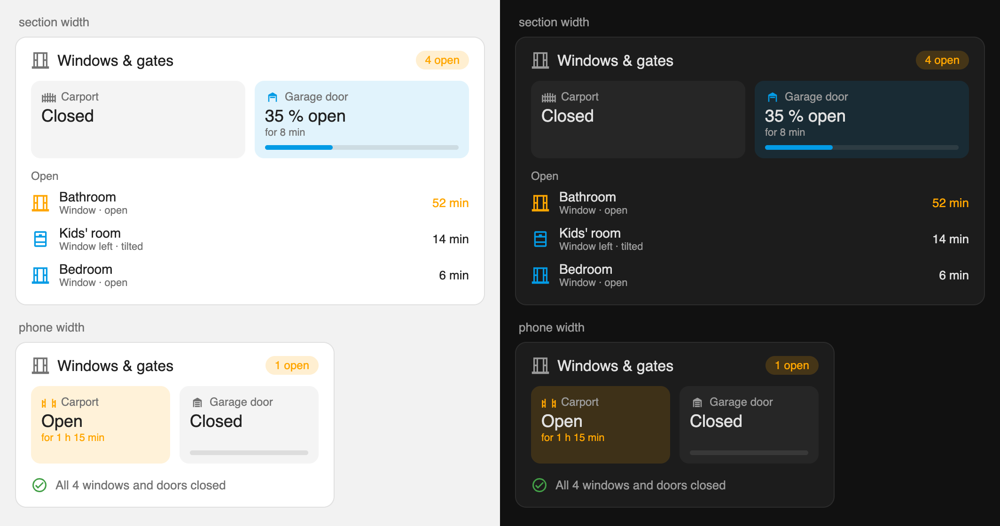
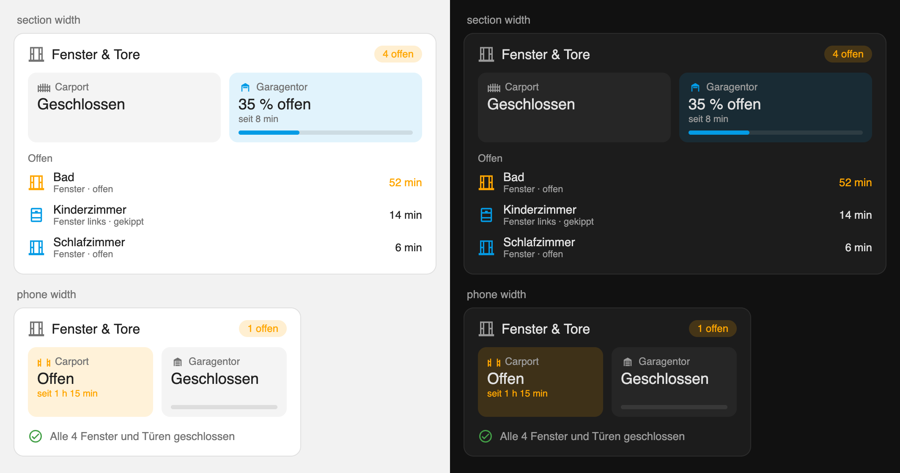

<p align="center">
  <a href="https://my.home-assistant.io/redirect/marketplace_repository/?owner=yannick80&repository=ha-house-openings-card&category=plugin">
    
  </a>
</p>
<p align="center">
  <a href="https://github.com/yannick80/ha-house-openings-card/releases/latest"></a>
  <a href="https://www.home-assistant.io"></a>
  <a href="https://github.com/yannick80/ha-house-openings-card/actions/workflows/validate.yml"></a>
  <a href="LICENSE"></a>
</p>

# House Openings Card

A Home Assistant dashboard card that shows which windows and doors are open, and for how long, and keeps your garage doors and gates in view all the time: closed, open, or how far open.

**No configuration needed.** The card finds window and door contacts through the areas you have already assigned, and garage doors and gates by their device class.



<!-- ha-marketplace:exclude-start -->
**Contents:**
[What the card shows](#what-the-card-shows) ·
[Before you start](#before-you-start) ·
[Installation](#installation) ·
[Add the card](#add-the-card) ·
[How contacts and gates are found](#how-contacts-and-gates-are-found) ·
[Options](#options) ·
[Troubleshooting & FAQ](#troubleshooting--faq) ·
[For developers](#for-developers)
<!-- ha-marketplace:exclude-end -->

## What the card shows

| Part | Shows |
|---|---|
| **Status badge** | *All closed* (green), *3 open* (blue), orange once something has been open longer than `warn_minutes` (30 by default) |
| **Gates** | One tile per garage door or gate, always shown: *Closed*, *Open*, *35 % open* (with a position bar, if the cover reports a position), *Opening …*, *Closing …* or *Unknown*, plus how long it has been open |
| **Open windows and doors** | Area, contact name, *open* or *tilted*, and how long, longest first. Orange once over `warn_minutes`. |
| **All closed** | One line: *All 12 windows and doors closed* |
| **Unavailable** | *2 sensors unavailable*, e.g. an empty battery. Hover for the names, tap to open the first one. |

Tap a gate tile or a window to open its more-info dialog, where you can also open or close a gate.

<details>
<summary>German interface (Deutsch)</summary>



</details>

## Before you start

- [ ] **Home Assistant 2024.12 or newer.**
- [ ] **Your window and door contacts are in areas.** Assigning the device is enough. Contacts without an area are still shown, just without a room name.
- [ ] **Garage doors and gates are covers** with the device class `garage` or `gate`. Otherwise list them under `gates`.

<!-- ha-marketplace:exclude-start -->
## Installation

### Home Assistant 2026.11 and newer (Marketplace)

[](https://my.home-assistant.io/redirect/marketplace_repository/?owner=yannick80&repository=ha-house-openings-card&category=plugin)

Or go to **Settings** > **Marketplace** > **Add from link**, enter `https://github.com/yannick80/ha-house-openings-card` (type **Dashboard**), install, and reload the browser.

### Home Assistant 2026.10 and older (HACS)

[](https://my.home-assistant.io/redirect/hacs_repository/?owner=yannick80&repository=ha-house-openings-card&category=plugin)

In HACS, add `https://github.com/yannick80/ha-house-openings-card` as a custom repository of type **Dashboard**, download it, and reload the browser.

### Manual installation

1. Download `house-openings-card.js` from the [latest release](https://github.com/yannick80/ha-house-openings-card/releases/latest) to `config/www/`.
2. Under **Settings** > **Dashboards** > three dots > **Resources**, add `/local/house-openings-card.js?v=0.1.0` as **JavaScript module**.
3. Reload the browser. Raise the `?v=` number after each update.
<!-- ha-marketplace:exclude-end -->

## Add the card

Search for **House Openings** in the card picker. Everything in the editor is optional.

```yaml
type: custom:house-openings-card
```

## How contacts and gates are found

**Windows and doors** are all entities in the entity registry that

- are a `binary_sensor` with the device class `window`, `door`, `opening` or `garage_door`, or an enum `sensor` whose options include *tilted* (rotary window handles),
- are not diagnostic or hidden.

Skipped on purpose:

- **Thermostat "window open" detection**: contacts on a device that also has a `climate` entity. These are a thermostat's guess, not a contact.
- **A gate's own end switch**: contacts on the same device as a shown gate.
- **The same window twice**: if a device has a rotary handle enum sensor, its binary sensor is left out.
- **Appliance doors**: air fryer, oven, steam oven, microwave, dishwasher, washing machine, dryer, fridge, freezer, wine cooler and coffee machine. They are recognised by the entity ID, name or translation key and by the device's name or model, and every contact of the integrations `miele_lan`, `miele`, `home_connect`, `vesync` and `philips_airfryer` is skipped. Turn this off with `auto_exclude: false`; anything it misses goes into `exclude_entities`.

**Tilted:** shown for enum sensors in the state *tilted*, and for binary sensors with the attribute `window_state: TILTED` (Homematic IP rotary handle HmIP-SRH).

**Names:** the area name is taken off the front of the contact name, so *Bathroom window* in the bathroom shows as *Window*.

**Gates** are all covers with the device class `garage` or `gate`, sorted by name. If a cover reports `current_position`, the tile shows the percentage and a bar (e.g. a Homematic IP garage door module). Without one (e.g. a Somfy gate through Overkiz), it shows *Open* or *Closed*. Somfy RTS motors give no feedback; Home Assistant may then show the last command or *unknown*, and the card shows *Unknown*.

## Options

| Option | Default | Description |
|---|---|---|
| `title` | *Windows & gates* / *Fenster & Tore* | Card title |
| `gates` | all `garage` and `gate` covers | Covers to show as tiles, in this order. Entries are an entity ID or `{ entity, name, icon }`. `gates: []` shows none. |
| `windows` | automatic | Only these contacts, instead of discovery |
| `areas` | all areas | Only contacts in these areas |
| `exclude_areas` | – | Leave out contacts in these areas |
| `exclude_entities` | – | Contacts or gates to leave out |
| `warn_minutes` | `30` | Highlight in orange when open longer; `0` turns it off |
| `auto_exclude` | `true` | Skip appliance doors (air fryer, oven, dishwasher, …) |

### Example

```yaml
type: custom:house-openings-card
gates:
  - entity: cover.hcu_garagentor
    name: Garage
  - entity: cover.carport_tor
    name: Carport
    icon: mdi:gate
exclude_entities:
  - binary_sensor.dachfenster_regensensor
warn_minutes: 20
```

## Troubleshooting & FAQ

**A window is missing.** Check under **Developer tools** > **States** that its `device_class` is `window`, `door`, `opening` or `garage_door`, that it is not a diagnostic entity, and that its device has no `climate` entity. If it still doesn't show, list your contacts under `windows`.

**Something shows up that isn't a window**, e.g. an appliance the filter doesn't know. Put it into `exclude_entities`, and please [open an issue](https://github.com/yannick80/ha-house-openings-card/issues/new/choose) with its entity ID, integration and device name, so the filter can learn it.

**A gate is missing.** Its `device_class` is not `garage` or `gate`. Add it under `gates`, or change the device class under the entity's settings (**Show as**).

**The card shows the old version.** Reload with the cache cleared. The browser console shows `house-openings-card x.y.z`.

Issues: [github.com/yannick80/ha-house-openings-card/issues](https://github.com/yannick80/ha-house-openings-card/issues/new/choose). Please include the card version, Home Assistant version, your YAML, and for a missing or wrong contact its entity ID, integration and attributes.

## For developers

One plain JavaScript file, `dist/house-openings-card.js`, no build step or dependencies. Tests need only Node.js 22: `node --test tests/*.mjs`. Preview images: `sh docs/render-previews.sh` (Google Chrome and Python 3). See [AGENTS.md](AGENTS.md) and [CHANGELOG.md](CHANGELOG.md).

Icons from [Material Design Icons](https://pictogrammers.com/library/mdi/).

## License

[MIT](LICENSE)
